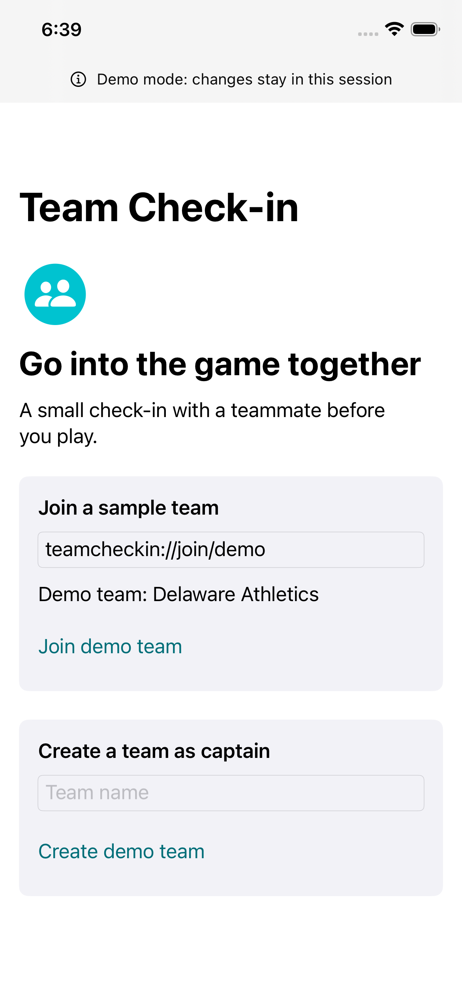

# Team Check-in

Purpose: Build a simple native iPhone app that helps student athletes connect privately before games. One hour before a game, teammates receive an invitation to share how they feel and find each other at warmups.

Current status: Working portfolio prototype with a deployed development backend. Hosted Swift service tests verified multi-account schedules, private pair/trio check-ins, photos, warmup acknowledgments, and deletion. A real scheduled game opened through server cron. The latest verified source passed six simulator UI tests (including both accessibility audits), two native Keychain/photo tests, 51 portable behaviors, and 26 offline Node tests. Manual VoiceOver, native hosted account/relaunch review, email confirmation, physical camera/permissions, and Apple push receipt remain outstanding. Team Check-in is a temporary working title.

## Features

First-version scope:

- Join through a team invite link.
- Captain-managed game schedules.
- Server-generated random pairs, with one trio for an odd roster.
- A private feeling/support check-in with an optional note and photo.
- Brief encouragement and "Find me at warmups" requests with acknowledgment.
- Scheduled pregame notifications.

Captain status does not grant access to other pairings' responses or photos.

## Screens and design

See [screen flows](docs/SCREEN_FLOWS.md) and [interface conventions](docs/DESIGN_SYSTEM.md). The image below is an actual verified simulator capture of the labeled demo welcome screen.



## Tech stack

- Swift 6 and SwiftUI, initially targeting iOS 17 or newer.
- Main-actor view models and protocol-based service injection.
- Supabase Auth and Postgres for prepared account/team/check-in persistence; private Storage for optional assignment photos.
- Injected mock services for the first local prototype.

## Getting started

Xcode 26.3 is installed on the current development Mac. The app targets iOS 17 or newer and uses demo data without credentials. Open `TeamCheckIn.xcodeproj`, select an installed iPhone simulator, and run the TeamCheckIn scheme.

Verify the local tools:

```sh
xcode-select -p
xcodebuild -version
xcodebuild -checkFirstLaunchStatus
xcrun simctl list runtimes
```

Build from the project directory:

```sh
xcodebuild -project TeamCheckIn.xcodeproj -scheme TeamCheckIn -destination 'generic/platform=iOS Simulator' -derivedDataPath build CODE_SIGNING_ALLOWED=NO build
```

This build passed locally. The shared scheme also includes simulator UI tests; see [native review](docs/PROTOTYPE_REVIEW.md) for commands and review boundaries. Full VoiceOver and device checks remain pending.

The sample invitation is `teamcheckin://join/demo`. Today includes reproducible demo scenarios; Team includes a Captain demo toggle. Warmup acknowledgments can be simulated explicitly. Photos stay in memory, and session data resets when the app relaunches.

Regenerate the project after adding Swift app files:

```sh
python3 scripts/generate_xcode_project.py
```

Configured account mode uses a Supabase host and publishable key from ignored `Config.xcconfig`. See [backend setup](docs/BACKEND_SETUP.md) for local services and [hosted development](docs/HOSTED_DEVELOPMENT.md) for the deployed project and remaining integration checks. Privileged credentials belong only in trusted server configuration; never put them in the app or repository.

## Architecture and project files

- `docs/PRODUCT_SPEC.md`: Behaviors, privacy boundaries, edge cases, and defaults.
- `docs/SCREEN_FLOWS.md`: Screen states and feature-to-screen mapping.
- `docs/DESIGN_SYSTEM.md`: Native visual and accessibility conventions.
- `docs/DEPENDENCIES.md`: Setup status, dependencies, and proposed source layout.
- `PROJECT_PLAN.md`: Seven phases and acceptance criteria.
- `BUILD_LOG.md`: Work completed, checks, blockers, and next actions.
- `AGENTS.md` and `.agents/skills/`: Project development instructions.

## Testing

Run portable core tests:

```sh
swift test
```

Fifty-one executed portable tests cover prototype boundaries, invalid invitations, secure session renewal, logout failures, failed-save draft preservation, assignment changes, game cancellation/rollover, photo upload retry/draft cleanup, private state cleanup, strict game routes, queued notification taps, account-scoped event navigation, optional permission, device registration retries, sign-out races, and confirmed/partial account cleanup, private participation choices, and live clock boundaries. The package tests run on macOS. A separate app-hosted simulator test verifies the actual Keychain vault; the full native account flow and physical-device storage remain pending. The [verified CI run](https://github.com/ssmitty/team-check-in-ios/actions/runs/40622887220) passed the native build, six UI checks, two Apple API contracts, core/pairing tests, and backend integration for source commit `3264697`. The optional real-backend integration is skipped by the default portable run.

The server pairing, scheduler authorization, and APNs preparation modules have 26 passing Node tests:

```sh
node --test backend/pairing.test.mjs backend/apns.test.mjs backend/apnsDelivery.test.mjs backend/pushWorker.test.mjs backend/schedulerAuthorization.test.mjs
```

See [pairing module](backend/README.md) for exact and bounded-search behavior. The worker and database persistence have been exercised locally and on the authorized development host; see [hosted verification](docs/HOSTED_VERIFICATION.md). Mock assignments stay separate from account mode.

A separate opt-in test exercises the shipped Swift account, team, photo, and warmup services against real local APIs using seven synthetic accounts:

```sh
python3 scripts/run_swift_backend_integration.py
```

It uses a test-only loopback transport and in-memory session vault, so it does not establish hosted HTTPS, iPhone UI, or Keychain behavior. See [backend setup](docs/BACKEND_SETUP.md). It is skipped by the default unit-test command.

Verify secure storage and photo metadata removal in an ad-hoc signed simulator app using an installed runtime:

```sh
python3 scripts/run_native_platform_tests.py
```

The runner keeps generated files outside the project folder, where file-provider attributes caused an ad-hoc signing failure. It uses synthetic data and clears its own isolated Keychain entry. No Apple account is needed for this simulator signature. See [native review](docs/PROTOTYPE_REVIEW.md) for the passing welcome accessibility audit and the remaining manual VoiceOver and additional-screen review.

Run the same real API suite inside a signed iOS simulator app with actual Keychain storage:

```sh
python3 scripts/run_ios_backend_integration.py --simulator-id YOUR_SIMULATOR_ID
```

This opt-in suite passed using seven synthetic accounts, private pair/trio data, binary photos, warmups, restored native sessions, and own-account deletion. The test-only loopback adapter does not change the shipped app's HTTPS/ATS settings. Native account screens and physical-device behavior remain separate checks. A separate hosted run now verifies the same Swift services over real TLS using provisioned synthetic identities; see [hosted verification](docs/HOSTED_VERIFICATION.md).

Swift formatting uses Xcode's bundled `swift-format` and `.swift-format` configuration.

## Roadmap and known limitations

The authorized [hosted development backend](docs/HOSTED_DEVELOPMENT.md) is now deployed, with a verified recurring opening-worker HTTP invocation and a private photo bucket. Its public client configuration is supplied locally. Hosted multi-account Swift service tests and a real scheduled game opening passed. Successful account controls, app relaunch, email confirmation, and Apple device delivery remain pending. Earlier local-verification notes below do not establish those remaining checks.

Next: review successful hosted accounts and app relaunch through native controls, then complete manual VoiceOver and permission recovery checks. The simulator demo, largest-text dark mode, captain schedule controls, account audit, and welcome audit pass in cloud CI. Private photo/warmup service integration and real cron opening also passed on the dedicated development project. Camera capture is implemented but requires physical verification.

Apple push registration/routing and a leased Node HTTP/2 delivery worker are prepared, with mock APNs tests. Actual delivery still requires Apple signing/provider credentials, approved worker hosting, and a physical iPhone. Email sender/confirmation, retention selection, and final naming remain necessary before a pilot. See the [pilot guide](docs/PILOT_GUIDE.md) and [hosted verification](docs/HOSTED_VERIFICATION.md).

## Scheduled work

The starting cadence is nightly at 2:00 AM Eastern in the existing chat. Each run reads the saved plan and build log. The Mac must be awake and online with the desktop app running for local execution.

## Version control

Project commits use the personal `ssmitty` account. Meaningful completed changes receive small commits after relevant checks, with private GitHub synchronization after a secrets scan. See [Git workflow](docs/GIT_WORKFLOW.md). Local backend settings belong in ignored `Config.xcconfig`; `Config.example.xcconfig` contains placeholders; the app target includes ignored `Config.xcconfig` through `BuildConfig.xcconfig`.

## License

The GitHub repository was initialized with the [MIT License](LICENSE). The app has not been distributed to testers or the App Store.
